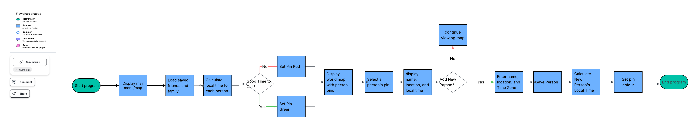

# WorldConnect

WorldConnect is a Java project that helps people keep track of friends and family who live in different time zones. It uses a simple map with colored pins to show if it is a good time to call someone.

## The Problem

A lot of my friends and family live in different countries, so I end up checking different time zones pretty often. Sometimes it is hard to know if it is too early or too late to call someone. I wanted to make something simple that makes that easier.

## How It Works

The user can add a person with their name, location, and time zone. The program will calculate their local time and show them as a pin on a world map.

- Green pin = good time to call
- Red pin = probably not a good time to call
- Clicking a pin will show the person's name, location, and local time

The program will also save the people that were added so they can be loaded again later.



## Tech Stack

- **Language:** Java
- **Libraries:** `java.time`
- **External tools:** Git and GitHub
- **API:** I may use `HttpClient` with a public time zone or location API
- **Data storage:** CSV or text file

## Setup

```bash
git clone https://github.com/Shreshthabasu7/WorldConnect
cd WorldConnect
```

The project is still being planned, so I will add the rest of the setup instructions once I start building it.

## Usage

The user will open the program and see the saved people on a world map. The pin color will show if it is a good time to call, and the user can select a pin to see more information about that person.

```bash
# More run instructions will be added once the program is built.
```

## Roadmap

- [ ] Find a good time for a group call
- [ ] Add birthdays and important dates
- [ ] Add reminders
- [ ] Add more detailed availability times

## Author

Shreshtha Basu  
https://github.com/Shreshthabasu7
